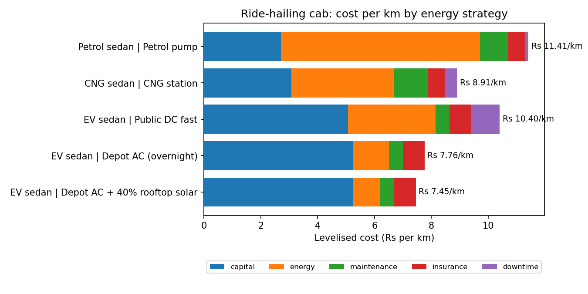
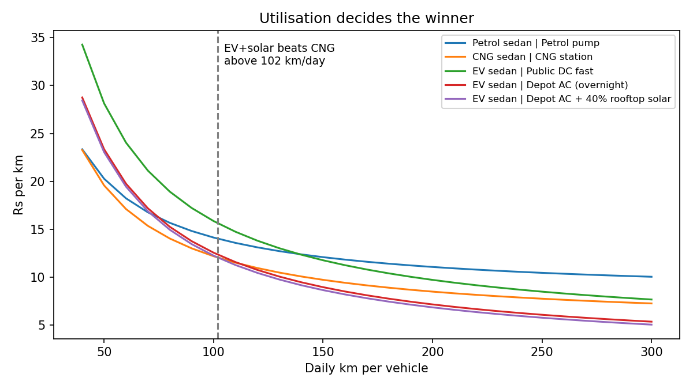
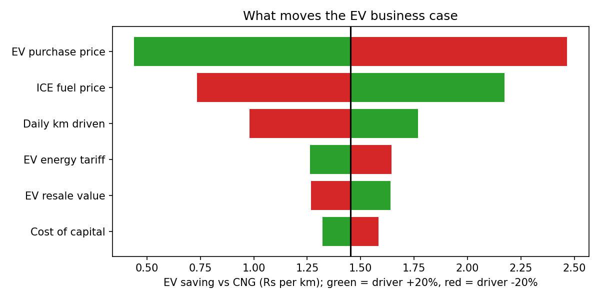

# EV Fleet TCO & Energy Strategy Model

A first-principles model of what an Indian ride-hailing or delivery fleet pays per kilometre: petrol vs CNG vs EV, and for EVs which charging strategy to use (public DC fast charging, overnight depot charging, depot charging with rooftop solar, or battery swapping).

Each cost starts from its physical and commercial drivers: purchase price, kWh or litres per km, tariff, maintenance per km, insurance, resale, mid-life battery replacement, and **downtime** (minutes a driver spends charging or refuelling instead of earning). All of it is discounted and levelised to **₹ per km over the vehicle's life**, so very different cost structures can be compared directly.

## Key results (illustrative 2026 assumptions)

| Cab option (180 km/day) | ₹/km |
|---|---|
| Petrol sedan | 11.41 |
| CNG sedan | 8.91 |
| EV, public DC fast charging | 10.40 |
| EV, depot AC overnight | 7.76 |
| **EV, depot AC + 40% rooftop solar** | **7.45** |

- An EV with depot charging and solar is **16% cheaper per km than CNG**. For a 100-cab fleet that is about **₹87 lakh a year**.
- The charging strategy matters as much as the vehicle. An EV that relies on public DC fast charging costs **40% more per km** than depot + solar, and it costs more than CNG.
- **Breakeven utilisation:** EV + solar beats CNG only above **~102 km/day**. Below that, the EV's higher capital cost is not recovered.
- For 2-wheelers, home/depot charging costs ₹1.76/km against ₹3.59/km for petrol. Battery swapping (₹2.74/km) cuts upfront capex by ~42% but gives back most of the energy saving. That makes it a cash-flow decision, not a cost decision.
- **EV purchase price** is the biggest swing factor: ±20% moves the per-km saving by ₹2.03.





## Run it

```bash
pip install -r requirements.txt
python run.py          # writes outputs/*.csv, *.png, summary.md
python -m pytest -q    # sanity tests
```

All assumptions live in [`ev_tco/scenarios.py`](ev_tco/scenarios.py). Change a tariff or a vehicle price and rerun.

## How it works

- `levelised_cost()`: NPV of all costs ÷ NPV of km driven, split into capital, energy, maintenance, insurance and downtime.
- `breakeven_km_per_day()`: Brent's root-finding on the cost gap between two options.
- `tornado()`: moves each driver ±20% and ranks drivers by how much they shift the EV saving.

*The assumptions are illustrative public-domain estimates, not data from any company.*
